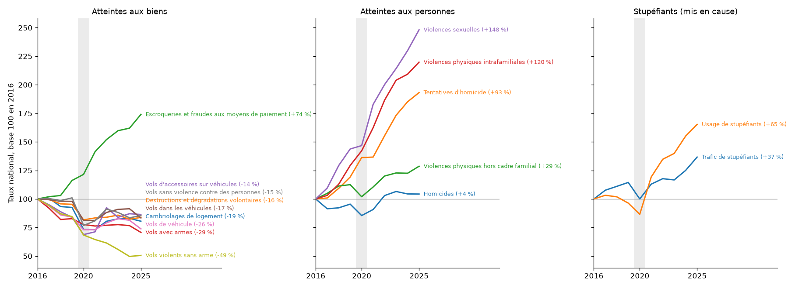
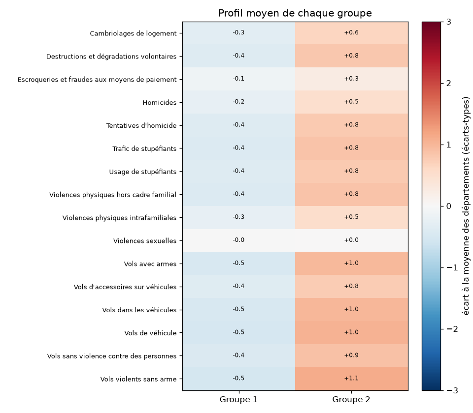
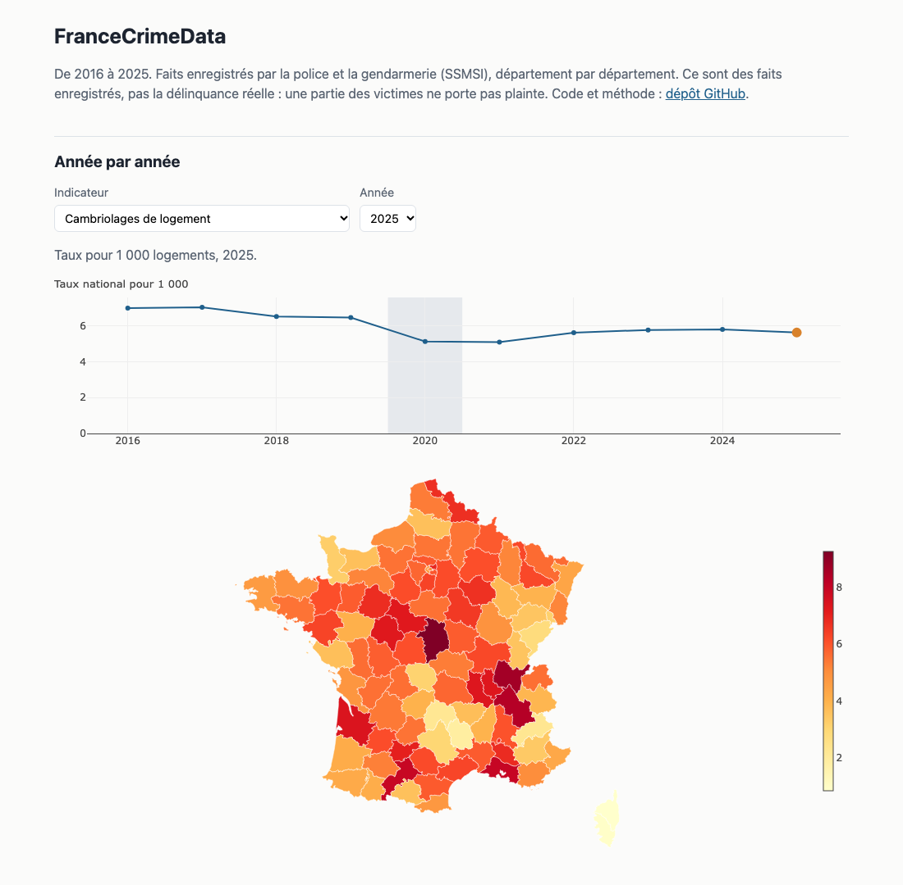
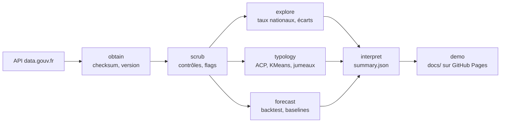

<div align="center">

# FranceCrimeData

**La délinquance augmente-t-elle en France ? Ce que disent les chiffres de la police et de la gendarmerie, département par département, de 2016 à 2025.**

Données ouvertes du ministère de l'Intérieur · nettoyage vérifié · ACP et clustering · prévision en backtest · carte interactive

[](https://github.com/nolancolin/FranceCrimeData/actions/workflows/ci.yml)

[](LICENSE)



**[Ouvrir la carte interactive](https://nolancolin.github.io/FranceCrimeData/)**

[Le projet](#le-projet) · [Ce que montrent les chiffres](#ce-que-montrent-les-chiffres) · [Prévoir l'année suivante](#prévoir-lannée-suivante) · [Profils de départements](#des-profils-de-départements) · [Essayer](#essayer) · [Méthode](#comment-ça-marche) · [Limites](#les-limites)

</div>

## Le projet

On parle beaucoup d'insécurité en ce moment, et on entend souvent un seul chiffre : « la délinquance explose », ou au contraire « elle baisse ». Je voulais savoir ce que disent vraiment les données officielles.

Chaque année, le service statistique du ministère de l'Intérieur (SSMSI) publie les faits enregistrés par la police et la gendarmerie, pour chaque département et 18 types de faits : cambriolages, vols de véhicule, violences sexuelles, escroqueries, trafic de stupéfiants... J'ai pris toute la série, de 2016 à 2025, la dernière année publiée (juillet 2026), et je l'ai analysée de bout en bout :

1. télécharger les données et noter leur version exacte ;
2. les nettoyer sans rien abîmer ;
3. regarder comment chaque type de faits évolue, et où ;
4. regrouper les départements qui se ressemblent ;
5. essayer de prévoir l'année suivante, et vérifier honnêtement si ça marche ;
6. tout mettre sur une carte interactive.

Ce projet est né d'un projet de groupe en L2 (2025). Je l'ai entièrement repris et réécrit seul en 2026.

Ce qui m'a le plus appris :

- **Un nettoyage peut fabriquer des erreurs.** La première version « corrigeait » les taux des cambriolages, qui sont publiés pour 1 000 logements et pas pour 1 000 habitants. Elle plafonnait aussi la population de Paris ou du Nord comme si c'étaient des valeurs aberrantes. Maintenant, rien n'est supprimé ni corrigé : les anomalies sont signalées.
- **Comparer en taux, jamais en nombres.** Le Nord aura toujours plus de faits que la Lozère, juste parce qu'il est plus peuplé. La question utile, c'est le taux.
- **Un modèle qui ne bat pas la baseline, c'est un résultat.** Pour prévoir l'année suivante, recopier l'année en cours fait mieux que mon gradient boosting. J'explique pourquoi plus bas.
- **Des données récentes, une méthode testée sur le passé.** Les prévisions sont validées sur 2022, 2023, 2024 et 2025, chaque année étant prédite seulement avec les années d'avant.

## Ce que montrent les chiffres

La réponse courte : « la délinquance » en un seul chiffre, ça n'a pas de sens. Les vols et les violences ne vont pas du tout dans le même sens.

- **Les vols baissent.** Entre 2016 et 2025, le taux de vols violents sans arme a baissé de 49 %, celui des vols avec armes de 29 %, celui des vols de véhicule de 26 %, celui des cambriolages de 19 %.
- **Les violences enregistrées montent fort.** Violences sexuelles +148 %, violences physiques intrafamiliales +120 %, tentatives d'homicide +93 %. Une partie de cette hausse peut venir de victimes qui portent plus souvent plainte. Les données seules ne permettent pas de faire la part des choses.
- **Les escroqueries suivent leur propre courbe.** +74 % sur la période, et elles sont les seules atteintes aux biens à ne pas baisser en 2020.
- **En 2025**, le trafic de stupéfiants (+9,3 %), les violences sexuelles (+7,9 %) et les escroqueries (+7,4 %) progressent encore. Les vols de véhicule (-9,3 %) et les vols dans les véhicules (-8,8 %) reculent.

Quelques résultats qui m'ont surpris :

- Les tentatives d'homicide ont presque doublé (+93 %), mais le taux d'homicides, lui, est quasiment stable (+4 %).
- Les violences sexuelles sont l'indicateur où les départements se ressemblent le plus : le 90e centile n'est que 1,43 fois au-dessus du 10e. Pour les vols violents sans arme, c'est 6,63 fois. Et c'est le seul indicateur au même niveau dans les deux groupes de départements (voir plus bas).
- L'usage de stupéfiants (+65 %) décolle juste après 2020, l'année où les amendes forfaitaires apparaissent dans les données. Ce chiffre compte des personnes contrôlées : il suit aussi l'activité des forces de l'ordre.
- Paris ne ressemble à aucun autre département : son plus proche « jumeau », le Rhône, est à une distance de 6,04, alors que la Sarthe a un jumeau, la Vienne, à 1,84.

## Prévoir l'année suivante

Pour chaque couple (département, type de faits), je prédis le taux de l'année N en n'utilisant que les années d'avant. Je le fais pour 2022, 2023, 2024 et 2025 (backtest glissant) et je compare trois méthodes. L'erreur est mesurée sur log(1 + taux pour 100 000), pour qu'un écart de 10 % compte pareil sur un petit et un grand taux.

| Année prédite | Recopier l'année précédente | Tendance sur 3 ans | Gradient boosting |
|---|---|---|---|
| 2022 | 0,167 | 0,226 | 0,215 |
| 2023 | 0,140 | 0,184 | 0,142 |
| 2024 | 0,134 | 0,181 | 0,132 |
| 2025 | 0,143 | 0,178 | 0,141 |
| **Moyenne** | **0,146** | 0,192 | 0,158 |

En clair, recopier l'année précédente se trompe d'environ 15,7 % sur le taux. Le modèle se trompe d'environ 17,1 %.

Le modèle rate surtout 2022. Il n'avait appris que sur 2019, 2020 et 2021, donc sur le confinement et le rebond qui a suivi, et il prolonge des variations qui ne se répètent pas. De 2023 à 2025, il fait jeu égal : l'écart avec la baseline va de -0,0019 à +0,0019 et l'intervalle bootstrap à 95 % contient zéro chaque année.

Par type de faits, il gagne sur 8 des 16. Il gagne surtout sur ceux qui montent régulièrement, comme les violences intrafamiliales (0,062, contre 0,079 pour la tendance et 0,090 pour l'année précédente). Il gagne aussi sur les petits effectifs comme les homicides, où il lisse le bruit. Il perd sur les cambriolages (0,183 contre 0,121) et sur la plupart des vols, sauf les vols avec armes. Avec 10 années, dont une hors norme, il n'y a pas grand-chose à apprendre de plus que « l'an prochain ressemblera à cette année ».


## Des profils de départements

Chaque département est décrit par ses 16 taux (moyenne des 3 dernières années, passés au log puis standardisés). Sur ce profil :

- **L'ACP** montre un premier axe qui explique 45 % de la variance, avec tous ses poids positifs. C'est un niveau général, porté d'abord par les vols. Le deuxième axe (19 %) oppose les homicides et violences aux escroqueries.
- **Le clustering** sépare 2 groupes : 68 départements sous la moyenne sur presque tout, et 33 au-dessus (notamment les grandes agglomérations, l'Île-de-France, le pourtour méditerranéen, les Antilles, la Guyane et Mayotte). Les violences sexuelles sont la seule exception : même niveau dans les deux groupes (-0,01 et +0,02 écart-type).
- **Les départements jumeaux** sont les 5 profils les plus proches de chaque département. On peut les chercher sur la carte.

J'ai comparé KMeans et Ward pour k de 2 à 8, sur la silhouette et la stabilité (ARI moyen sur 50 tirages de 80 % des départements). Ward n'est stable pour aucun k (ARI max 0,577). KMeans avec k = 2 a la meilleure silhouette (0,313) et une stabilité de 0,957. Avec k = 3, la silhouette est presque la même (0,309) : on sépare juste un petit groupe de 4 départements. Une silhouette autour de 0,3 veut dire que les groupes existent mais se recouvrent. Pour un département précis, ses jumeaux en disent plus que son groupe.



## La carte interactive

**[nolancolin.github.io/FranceCrimeData](https://nolancolin.github.io/FranceCrimeData/)**

On choisit un type de faits et une année : la carte des taux s'affiche avec la courbe nationale. Plus bas, la carte des groupes et la recherche des jumeaux d'un département. La page est statique et générée par le pipeline.



## Essayer

Il faut Python 3.11 ou plus et `make` :

```bash
git clone https://github.com/nolancolin/FranceCrimeData.git
cd FranceCrimeData
make install
make all
```

```
INFO delinquance.obtain: dataset last modified 2026-07-09T12:01:37.059000+00:00
INFO delinquance.scrub: 18180 rows kept, report in scrub_report.json
INFO delinquance.typology: chosen clustering: kmeans with k=2
INFO delinquance.forecast: overall MAE: {'mae_naive': 0.146, 'mae_trend': 0.1923, 'mae_gbm': 0.1576}
INFO delinquance.demo: demo written to docs
```

`make all` télécharge la dernière version des données, refait toutes les étapes et régénère `reports/` et `docs/` en une dizaine de secondes. Deux exécutions donnent des fichiers identiques.

| Commande | Effet |
|---|---|
| `make install` | crée le `.venv` et installe le projet |
| `make data` | télécharge seulement les données |
| `make all` | refait tout le pipeline |
| `make test` | lance les 28 tests, sur un extrait réel de la base, sans réseau |
| `make lint` | vérifie le code avec ruff |
| `python -m delinquance <étape>` | une seule étape : `obtain`, `scrub`, `explore`, `typology`, `forecast`, `interpret` ou `demo` |

## Comment ça marche

Le projet suit les étapes OSEMN : obtenir, nettoyer, explorer, modéliser, interpréter.



### Les données

La source est la [base statistique départementale de la délinquance enregistrée](https://www.data.gouv.fr/fr/datasets/621df2954fa5a3b5a023e23c/) du SSMSI : 18 180 lignes, 101 départements, de 2016 à 2025. Le fichier est retrouvé par son identifiant dans l'API, son checksum est vérifié et sa version exacte (URL, date, sha256) est notée dans [`reports/data_version.json`](reports/data_version.json). Les données brutes ne sont pas dans le dépôt.

Trois règles du SSMSI à garder en tête :

1. Ce sont des faits enregistrés, pas la délinquance réelle. D'après les enquêtes de victimation, les victimes de violences sexuelles portent beaucoup moins souvent plainte que les victimes de cambriolage.
2. Chaque indicateur a son unité (victime, infraction, véhicule, personne mise en cause). Additionner deux indicateurs d'unités différentes n'a pas de sens, donc je ne le fais jamais.
3. Les taux sont pour 1 000 habitants, sauf les cambriolages : pour 1 000 logements.

### Le nettoyage

Aucune ligne n'est supprimée ni modifiée. Chaque contrôle ajoute une étiquette dans une colonne `flags` : code de département, doublon, unité inattendue, valeur non numérique, taux qui ne correspond pas au nombre et au dénominateur. Le dénominateur de chaque indicateur est déduit des données : pour les cambriolages, seul le calcul par logement retombe sur le taux publié.

Bilan dans [`reports/scrub_report.json`](reports/scrub_report.json) : aucun taux incohérent, 90 lignes signalées pour Mayotte, dont la population de référence reste celle du recensement de 2017. Les deux sous-indicateurs « Usage de stupéfiants (AFD) » et « (hors AFD) » détaillent « Usage de stupéfiants ». Je les garde dans le fichier mais pas dans les analyses, pour ne rien compter deux fois. Il reste 16 indicateurs.

### La prévision

Un seul `HistGradientBoostingRegressor` de scikit-learn pour tous les couples. Il prédit la variation depuis l'année précédente à partir des trois derniers log-taux, de la dernière variation, de la variation moyenne des départements pour cet indicateur l'an passé, et de l'indicateur lui-même. Les hyperparamètres ont été fixés une fois, pas réglés sur les années de test. Un test remplace les années N et suivantes par du bruit et vérifie que la prédiction de N ne bouge pas : il n'y a pas de fuite.

### Où est quoi

```
src/delinquance/
  obtain.py      téléchargement via l'API, checksum, version
  scrub.py       lecture, contrôles, signalement des anomalies
  explore.py     taux nationaux, évolutions, écarts entre départements
  typology.py    profils, ACP, KMeans contre Ward, jumeaux
  forecast.py    backtest glissant, baselines, gradient boosting
  interpret.py   résumé chiffré dans reports/summary.json
  demo.py        page statique dans docs/
tests/           tests pytest et extrait de la base
reports/         tableaux et figures produits par le pipeline
docs/            carte interactive publiée sur GitHub Pages
```

Tous les chiffres de ce README viennent de [`reports/summary.json`](reports/summary.json) et des fichiers de `reports/`. Ils décrivent la version de juillet 2026 des données, la plus récente à ce jour.

## Les limites

Rien ici n'est causal. Un taux plus élevé dans un département ne dit pas pourquoi : densité, tourisme, présence policière, habitude de porter plainte, tout se mélange.

Les indicateurs ne mesurent pas tous la même chose. Les chiffres des stupéfiants comptent des personnes mises en cause : ils mesurent aussi l'activité des services. Les escroqueries sont comptées au lieu de résidence de la victime, les autres faits au lieu où ils se sont produits.

Les séries ont des ruptures. Les violences physiques ont été redéfinies en juillet 2025 (le SSMSI a révisé la série depuis 2016), et les amendes forfaitaires pour usage de stupéfiants n'existent que depuis 2020.

Dix années, dont 2020, c'est court pour apprendre quoi que ce soit à un modèle. La population de Mayotte date de 2017, ses taux récents sont donc probablement surestimés. L'outre-mer est inclus dans les analyses, mais affiché dans un tableau à côté de la carte, qui ne couvre que la métropole.

<details>
<summary><b>Ce qui a changé depuis la première version</b></summary>

La version de L2 suivait déjà OSEMN et cherchait des départements proches avec un KNN. En la relisant, j'ai relevé six problèmes, vérifiés sur les données :

| Problème de la V1 | Vérifié | Ce qui change |
|---|---|---|
| Plafonnement IQR de la population et des logements | Oui : ce sont les vrais chiffres des Bouches-du-Rhône, du Nord, du Rhône et de Paris | L'IQR est noté dans le rapport, rien n'est modifié |
| Taux des cambriolages « corrigés » pour 1 000 habitants | Oui : 1 010 lignes, exactement toutes celles des cambriolages, sont pour 1 000 logements | Dénominateur déduit des données |
| KNN et ACP sur le nombre brut de faits, la population et les logements | Oui, et le KNN n'était pas standardisé : la proximité mesurait la taille | Profil de taux, log, standardisé |
| Indices du KNN appliqués au mauvais tableau | En partie : le bon résultat sortait par chance grâce à l'ordre des lignes, mais la branche `overlap` ajoutait les premiers départements de la liste | `NearestNeighbors` directement sur le profil |
| Listes d'indicateurs et d'années codées en dur, lignes hors liste supprimées | Oui : avec la base actuelle, toute l'année 2025 et les indicateurs renommés disparaîtraient | Rien n'est supprimé, les listes servent seulement à contrôler |
| Une fonction d'outliers renvoyait un tableau jamais utilisé | Oui | Supprimée |

</details>

## Licence

Code sous licence MIT. Données : SSMSI, [Licence Ouverte 2.0](https://www.etalab.gouv.fr/licence-ouverte-open-licence/). Fond de carte : IGN Admin Express, simplifié par [france-geojson](https://github.com/gregoiredavid/france-geojson), Licence Ouverte.
