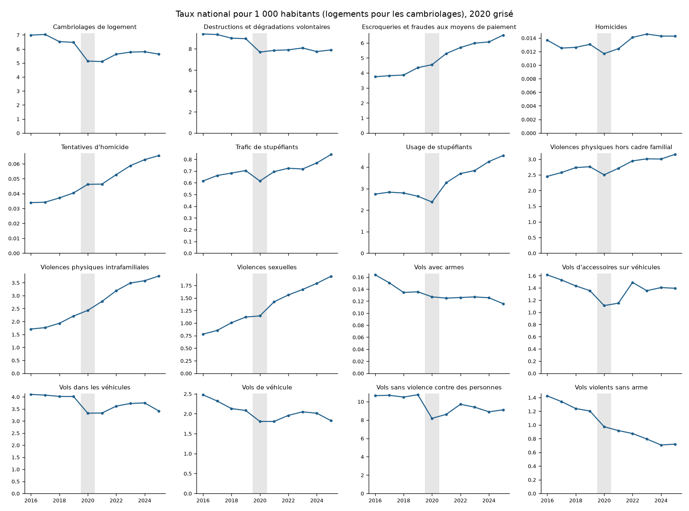
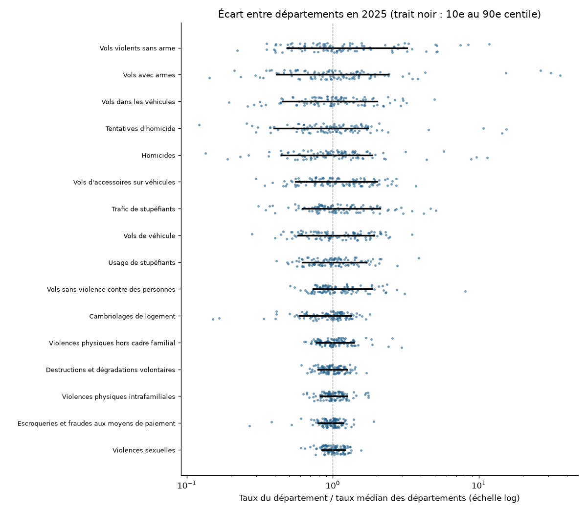
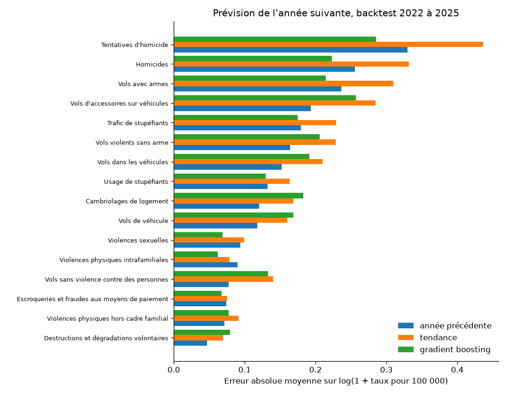

# Délinquance enregistrée dans les départements français

[](https://github.com/nolancolin/delinquance-france/actions/workflows/ci.yml)
[](LICENSE)

La question : les départements ont-ils des profils de délinquance enregistrée différents, et peut-on prévoir le taux de l'année suivante mieux qu'en recopiant celui de l'année précédente ?

Résultat principal. Sur un backtest de 2022 à 2025, recopier le taux de l'année précédente donne une erreur moyenne de 0,146 (sur le log du taux). Mon modèle de gradient boosting fait 0,158. Il perd nettement en 2022, puis fait jeu égal de 2023 à 2025 : l'écart reste dans l'intervalle de confiance. Côté typologie, la partition la plus nette et stable a 3 groupes (KMeans, silhouette 0,309, stabilité ARI 0,851).

Démo : [nolancolin.github.io/delinquance-france](https://nolancolin.github.io/delinquance-france/) (carte par indicateur et par année, carte des groupes, départements jumeaux).



Ce projet est né d'un projet de groupe en L2 (2025). Je l'ai entièrement repris et réécrit seul en 2026.

## Données

Source : [Bases statistiques communale, départementale et régionale de la délinquance enregistrée par la police et la gendarmerie nationales](https://www.data.gouv.fr/fr/datasets/621df2954fa5a3b5a023e23c/), SSMSI (ministère de l'Intérieur), sur data.gouv.fr. J'utilise la base départementale : 18 180 lignes, 101 départements, de 2016 à 2025. La version exacte (URL, date, sha256) est enregistrée dans [`reports/data_version.json`](reports/data_version.json).

Licence des données : [Licence Ouverte 2.0 (Etalab)](https://www.etalab.gouv.fr/licence-ouverte-open-licence/). Fond de carte : contours IGN Admin Express simplifiés par [france-geojson](https://github.com/gregoiredavid/france-geojson), Licence Ouverte.

Trois points de la documentation du SSMSI guident tout le reste :

- Ce sont des faits enregistrés, pas la délinquance réelle. D'après les enquêtes de victimation citées par le SSMSI, les victimes de violences sexuelles portent beaucoup moins souvent plainte que les victimes de cambriolage.
- Chaque indicateur a son unité de compte (victime, infraction, véhicule, mis en cause). Additionner des indicateurs d'unités différentes n'a pas de sens.
- Le taux est pour 1 000 habitants, sauf pour les cambriolages : pour 1 000 logements.

## Démarche (OSEMN)

### Obtain

`python -m delinquance obtain` interroge l'API de data.gouv.fr, retrouve le fichier par son identifiant de ressource, vérifie le checksum publié par l'API et note la version téléchargée. Les données brutes ne sont pas dans le dépôt.

### Scrub

Je ne supprime et ne corrige aucune ligne. Chaque contrôle ajoute un signal dans une colonne `flags` : codes, doublons, unités, valeurs non numériques, cohérence entre nombre, taux et dénominateur. Le dénominateur de chaque indicateur est déduit des données, pas supposé. Résultat dans [`reports/scrub_report.json`](reports/scrub_report.json) : aucun taux incohérent, 90 lignes signalées pour Mayotte (population figée sur le recensement de 2017). Les sous-indicateurs « Usage de stupéfiants (AFD) » et « (hors AFD) » sont la décomposition de « Usage de stupéfiants » : je les garde dans le fichier, mais pas dans les analyses, pour ne rien compter deux fois. Il reste 16 indicateurs.

### Explore

Deux figures, toujours en taux.

1. Comment les taux ont-ils évolué depuis 2016, et que s'est-il passé en 2020 ? (figure ci-dessus) Les plus fortes hausses entre 2016 et 2025 : violences sexuelles (+148 %), violences physiques intrafamiliales (+120 %), tentatives d'homicide (+93 %). Les plus fortes baisses : vols violents sans arme (-49 %), vols avec armes (-29 %), vols de véhicule (-26 %). En 2020, les vols sans violence (-24 %) et les cambriolages (-21 %) chutent puis remontent sans retrouver leur niveau de 2019.
2. À quel point les départements diffèrent-ils selon l'indicateur ? Le rapport entre le 90e et le 10e centile va de 1,43 (violences sexuelles) à 6,63 (vols violents sans arme). Les vols et les violences graves sont très concentrés, les violences sexuelles et intrafamiliales beaucoup moins.



### Model, partie 1 : typologie

Quels départements ont des profils semblables ?

- Profil d'un département : taux moyen des 3 dernières années pour chaque indicateur, passé au log (log(1 + taux pour 100 000)), puis standardisé. Sans cette étape, les gros indicateurs écraseraient les autres.
- ACP. Le premier axe explique 45 % de la variance et tous ses poids sont positifs : c'est un niveau général, surtout porté par les vols (vols violents sans arme 0,34, vols dans les véhicules 0,32). Le deuxième axe (19 %) oppose les homicides et violences (homicides -0,40) aux escroqueries (+0,50) : c'est ce qui distingue les Antilles, la Guyane et Mayotte.
- Clustering. Je compare KMeans et Ward pour k de 2 à 8, avec la silhouette et la stabilité (ARI moyen entre la partition complète et 50 partitions sur 80 % des départements). Ward n'est jamais stable (ARI max 0,577). Pour KMeans, je garde les k stables (ARI au moins 0,8) et je prends la meilleure silhouette ; k = 2 (0,313) et k = 3 (0,309) sont à égalité au centième près, je prends le plus détaillé. Une silhouette autour de 0,3 veut dire que les groupes existent mais se recouvrent.
- Les 3 groupes : 67 départements sous la moyenne sur presque tout, surtout les vols ; 30 départements plus urbains, au-dessus sur les vols (+1,08 écart-type pour les vols de véhicule) ; 4 départements d'outre-mer (Guadeloupe, Martinique, Guyane, Mayotte) avec des taux d'homicides très élevés (+3,96) et d'escroqueries bas (-3,02).
- Départements jumeaux : les 5 plus proches voisins dans l'espace du profil standardisé. Par exemple, la Sarthe (72) a pour jumeaux la Vienne, le Loiret, la Charente, l'Indre-et-Loire et l'Eure-et-Loir. Paris est loin de tout le monde : son plus proche jumeau, le Rhône, est à une distance de 6,04, contre 1,84 pour la Sarthe.


### Model, partie 2 : prévision de l'année suivante

Pour chaque couple (département, indicateur), je prédis le taux de l'année N.

- Backtest glissant : pour prédire N (de 2022 à 2025), le modèle s'entraîne sur les années cibles jusqu'à N-1 et ses variables n'utilisent que les années précédentes. Un test vérifie qu'en remplaçant les années N et suivantes par du bruit, la prédiction ne bouge pas.
- Baselines : la valeur de l'année précédente, et une tendance (dernière valeur plus la pente moyenne sur 3 ans).
- Modèle : un seul `HistGradientBoostingRegressor` pour tous les couples. Il prédit la variation depuis l'année précédente à partir des 3 derniers log-taux, de la dernière variation, de la variation moyenne de l'indicateur au niveau national et de l'indicateur. Les hyperparamètres sont fixés une fois, pas réglés sur le backtest.
- Mesure : erreur absolue moyenne (MAE) sur log(1 + taux pour 100 000), plus le WAPE par indicateur dans [`reports/forecast/scores_by_indicator.csv`](reports/forecast/scores_by_indicator.csv).

| Année testée | Année précédente | Tendance | Gradient boosting |
|---|---|---|---|
| 2022 | 0,167 | 0,226 | 0,215 |
| 2023 | 0,140 | 0,184 | 0,142 |
| 2024 | 0,134 | 0,181 | 0,132 |
| 2025 | 0,143 | 0,178 | 0,141 |
| Moyenne | 0,146 | 0,192 | 0,158 |

Le modèle ne bat pas la baseline. En 2022, il n'a appris que sur 2019, 2020 et 2021 : le choc de 2020 et le rebond de 2021. Il prolonge donc des variations qui ne se répètent pas. De 2023 à 2025, l'écart avec la baseline est entre -0,002 et +0,002, et l'intervalle bootstrap à 95 % contient zéro chaque année ([`reports/forecast/gbm_minus_naive.csv`](reports/forecast/gbm_minus_naive.csv)). Par indicateur, il gagne sur 8 des 16 : ceux qui montent régulièrement (violences intrafamiliales 0,062 contre 0,090, violences sexuelles 0,069 contre 0,094) et ceux à petits effectifs où il lisse le bruit (homicides). Il perd sur les vols et les cambriolages (0,183 contre 0,121), dont la série est cassée par 2020. Avec 10 années, dont une exceptionnelle, il y a peu de signal à apprendre au-delà de « l'an prochain ressemblera à cette année ».



### Interpret

Tous les chiffres de ce README viennent de [`reports/summary.json`](reports/summary.json) et des fichiers de `reports/`, produits par le pipeline.

## Ce que les résultats ne disent pas

- Rien de causal. Un taux plus élevé dans un département ne dit pas pourquoi : densité, tourisme, présence policière, propension à porter plainte, tout cela se mélange.
- Les hausses des violences sexuelles et intrafamiliales peuvent venir en partie d'une hausse des plaintes, pas seulement des faits.
- Les indicateurs de stupéfiants comptent des personnes mises en cause : ils mesurent aussi l'activité des services.
- Les escroqueries sont comptées au lieu de résidence de la victime, les autres indicateurs au lieu des faits.
- Ruptures de série : les violences physiques ont été redéfinies en juillet 2025 (série révisée depuis 2016 par le SSMSI), les amendes forfaitaires pour usage de stupéfiants n'existent que depuis 2020.
- Séries courtes (10 ans) et 2020 hors norme : les modèles ont peu d'années pour apprendre.
- Mayotte : la population de référence est celle de 2017 pour toutes les années, ses taux récents sont donc probablement surestimés.
- Outre-mer : inclus dans la typologie et les prévisions, mais pas sur les cartes de la démo (fond de carte métropolitain). Leurs valeurs sont affichées dans un tableau.

## Reproduire

Il faut Python 3.11 ou plus et `make`.

```bash
git clone https://github.com/nolancolin/delinquance-france.git && cd delinquance-france
make install
make all
```

`make all` télécharge les données, refait toutes les étapes et régénère `reports/` et `docs/` en une dizaine de secondes. `make test` lance les tests, sur un extrait de la base commité dans `tests/data/`, sans réseau.

## Structure

```
src/delinquance/
  obtain.py      téléchargement via l'API data.gouv.fr, checksum, version
  scrub.py       lecture, contrôles, signalement des anomalies
  explore.py     taux nationaux et écarts entre départements
  typology.py    profil, ACP, KMeans contre Ward, jumeaux
  forecast.py    backtest glissant, baselines, gradient boosting
  interpret.py   résumé des résultats (reports/summary.json)
  demo.py        page statique dans docs/
  __main__.py    point d'entrée : python -m delinquance <étape|all>
tests/           tests pytest et extrait de données
reports/         tableaux et figures produits par le pipeline
docs/            démo publiée sur GitHub Pages
```

## Ce qui a changé depuis la première version

La version de L2 suivait déjà OSEMN et cherchait des départements proches avec un KNN. En la relisant, j'ai relevé six problèmes et je les ai vérifiés sur les données.

1. Le nettoyage par IQR plafonnait la population et le nombre de logements. Les valeurs « aberrantes » étaient celles de vrais grands départements (Bouches-du-Rhône, Nord, Rhône, Paris). Maintenant, l'IQR est seulement calculé et noté dans le rapport, rien n'est modifié.
2. Les taux des cambriolages étaient « corrigés » en les recalculant pour 1 000 habitants. Ils sont pour 1 000 logements : sur la base actuelle, 1 010 lignes ne correspondent pas à un taux par habitant, et ce sont exactement toutes celles des cambriolages. Le dénominateur est maintenant déduit des données.
3. Le KNN et l'ACP utilisaient le nombre brut de faits (additionné entre unités différentes), la population et le nombre de logements, sans standardisation pour le KNN. La proximité mesurait surtout la taille. Les jumeaux sont maintenant calculés sur les taux, passés au log et standardisés.
4. Le regroupement des voisins mélangeait les indices du tableau groupé par département et ceux du tableau complet. Une partie donnait le bon résultat par chance, grâce à l'ordre des lignes du fichier ; la branche `overlap` ajoutait les premiers départements de la liste au lieu des vrais voisins. Ce code n'existe plus : les jumeaux viennent directement de `NearestNeighbors` sur le profil.
5. Les listes d'indicateurs et d'années étaient codées en dur et les lignes hors liste supprimées sans message. Avec la base actuelle, toutes les lignes de 2025 et celles des indicateurs renommés ou nouveaux auraient disparu. Maintenant, aucune ligne n'est supprimée et les unités attendues servent seulement à contrôler.
6. Une fonction de détection d'outliers renvoyait un tableau filtré jamais utilisé. Elle n'a pas d'équivalent ici.

J'ai aussi ajouté ce qui manquait : version des données, tests, prévision évaluée contre des baselines, et une démo.

## Licence

Code sous licence MIT. Données SSMSI sous Licence Ouverte 2.0.
